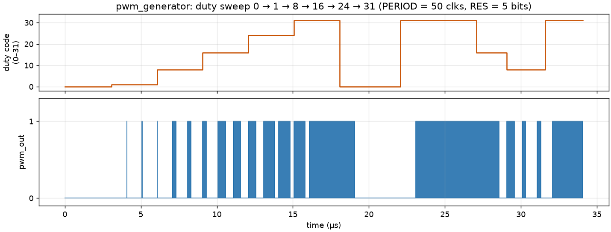
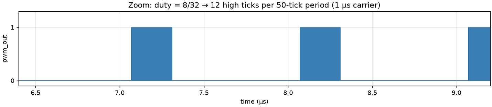
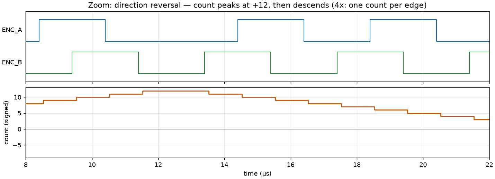

# FPGA digital control core (DE10-Lite)

A PWM generator and a quadrature encoder decoder written in Verilog for the Terasic DE10-Lite board (Intel MAX 10). These are the two pieces you need before you can close a motor control loop in hardware.

**Highlights**
- Wrote synthesizable RTL for a 20 kHz, 10-bit PWM generator with glitch-free duty updates and true 0 %/100 %
- Built a 4× quadrature decoder with input synchronizers, a glitch filter and an illegal-transition error flag
- Verified both with self-checking Icarus Verilog testbenches against independent models: **23/23 checks pass**
- Set up the Quartus project with a full pin map and timing constraints



## What I wanted to figure out

On an Arduino, PWM is coarse (about 490 Hz at 8 bits), and reading an encoder means one interrupt per edge, so it starts dropping counts at higher speed. I wanted to see what it takes to do both jobs in FPGA logic, where they run in parallel at 50 MHz and don't use any processor time.

## How it works

- **`rtl/pwm_generator.v`:** 20 kHz carrier with 10-bit duty by default (both are parameters). True 0% and 100% with no sliver pulses. Duty only updates at the start of a period, so changing it mid-cycle can't make a runt pulse. A `period_start` strobe can be used as the sample clock for a control loop.
- **`rtl/quadrature_decoder.v`:** 2-flop synchronizer plus a glitch filter on each channel, full 4x decode, a signed position count, a direction flag, and an error flag if the decoder sees an illegal jump (both channels changing at once).
- **`rtl/top_de10_lite.v`:** board wrapper. The switches set the duty, the LEDs show the encoder count, and the PWM comes out on the GPIO header.

## Results

Both testbenches check the design against an independent model and print PASS/FAIL. They don't just wiggle the inputs.

- **PWM:** 0% and 100% hold DC over several periods, a 1-tick minimum pulse, 25/50/75% duty accuracy, exact period length, and duty changes that only take effect on the next period
- **Decoder:** counting in both directions, reversals, glitch rejection, contact bounce, and the illegal-transition error flag

| PWM at 25% | Encoder reversal |
|---|---|
|  |  |

## Problems I ran into

Modeling asynchronous encoder glitches that are shorter than a clock cycle. That's the reason I used Icarus (event-driven, `#delay` timing) instead of Verilator. More detail is in `docs/design-notes.md`.

## Project status

- **Done:** RTL, self-checking testbenches (23/23 passing), waveform plots, Quartus project files
- **Not on hardware yet:** the design hasn't been compiled in Quartus or programmed onto the board
- **Next:** program the board and check the PWM on a scope, then add a PI/PID block between the encoder count and the PWM duty so the whole loop runs in the FPGA

## How to run it

```bash
sudo apt install iverilog      # or: brew install icarus-verilog
cd testbench
make                           # runs both testbenches, prints PASS/FAIL
python3 plot_waves.py          # regenerates the waveform images
```

Build and programming steps for the board are in [`synthesis/README.md`](synthesis/README.md).

## How I built it

I used Claude Code as a design assistant and I'm working through each part myself. The full write-up from before is in [`docs/design-notes.md`](docs/design-notes.md).
